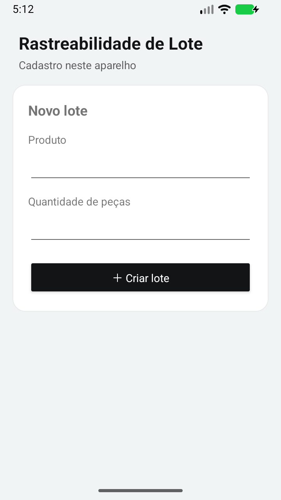
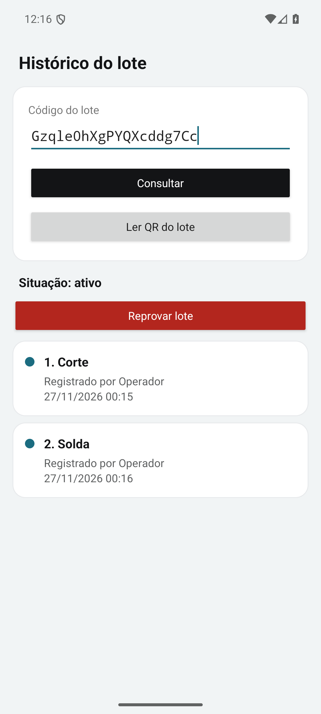
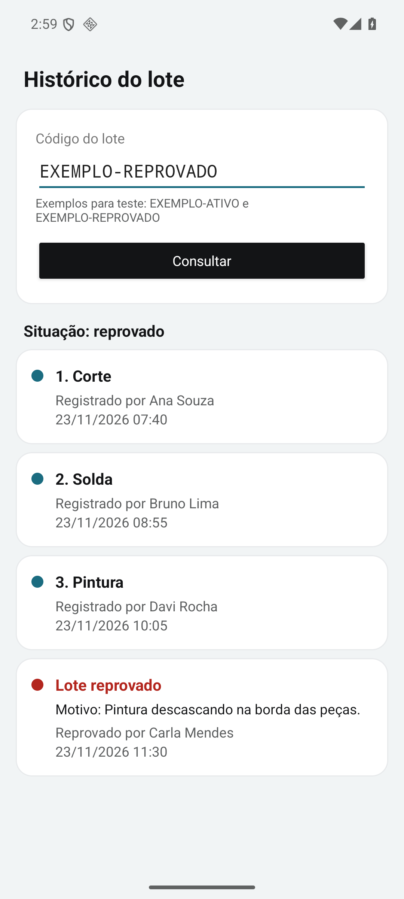

# Rastreabilidade de Lote

Aplicativo Android para identificar lotes de fabricação e consultar o que aconteceu com cada um. O Operador de etapa registra o produto e a quantidade e recebe uma etiqueta com QR Code. A Qualidade usa o código do lote para consultar seu histórico e, quando encontra uma não conformidade, registrar a reprovação com o motivo. Assim, os dois perfis consultam o mesmo registro de produção.

## Como funciona

| Operação | Quem usa | Resultado |
| --- | --- | --- |
| Cadastrar lote | Operador de etapa | O lote recebe um código único, data de criação, identificação do operador e situação inicial **Ativo**. |
| Identificar lote | Operador de etapa | Após a confirmação da gravação, o aplicativo exibe a etiqueta. O QR Code contém o identificador do lote. A última etiqueta pode ser recuperada pelo mesmo operador no aparelho. |
| Registrar etapa | Operador de etapa | O operador lê o QR Code, confere e confirma a próxima etapa. O aplicativo atualiza a etapa atual e grava o evento com UID, nome e horário do servidor. |
| Consultar histórico | Operador de etapa e Qualidade | A busca pelo código abre a situação do lote e os eventos em ordem cronológica. A tela acompanha as atualizações do Firestore e indica quando ainda não há eventos. |
| Reprovar lote | Qualidade | Em um lote ativo, a Qualidade informa um motivo de até 300 caracteres. A mudança para **Reprovado** e o evento com motivo, autoria e horário são gravados juntos. |

**Exemplo de uso.** Ao cadastrar 120 unidades de uma peça, o operador recebe a etiqueta. Depois do corte, ele lê o QR Code, confirma a etapa seguinte e o avanço aparece no histórico. Se a inspeção encontrar uma medida fora da tolerância, a Qualidade busca o código e registra a ocorrência. Ao consultar o lote, o operador passa a ver a reprovação e seu motivo.

**Em desenvolvimento.** As validações adicionais de salto, duplicidade e avanço após reprovação fazem parte das próximas implementações. [Acompanhar no quadro do projeto](https://github.com/users/PedroVazN/projects/1)

## Telas do aplicativo

| Cadastro e etiqueta | Consulta do histórico | Histórico de lote reprovado |
| --- | --- | --- |
|  |  |  |

## Acesso e contas de demonstração

A autenticação usa e-mail e senha. Cada conta tem um perfil definido pela equipe no Firestore. Uma conta recém-criada aguarda essa atribuição antes de acessar as operações. A opção **Sair** permite alternar entre as contas no mesmo aparelho.

| Conta de demonstração | Perfil no Firestore | O que experimentar |
| --- | --- | --- |
| Operador de etapa | `operador` | Cadastre um lote com quantidade inteira positiva, anote o código e abra a etiqueta. |
| Qualidade | `qualidade` | Consulte o mesmo código, registre uma reprovação e confira o motivo no histórico. |

As credenciais das contas de demonstração são disponibilizadas pela equipe em canal privado.

## Executar no Android Studio

O projeto usa Java 17, layouts XML, Android SDK 36 para compilação e Android 11 (API 30) ou superior no aparelho. O Gradle Wrapper acompanha o repositório.

1. Abra no Android Studio a pasta que contém `settings.gradle`.
2. Coloque a configuração Android do Firebase da equipe em `app/google-services.json`. O pacote registrado deve ser `br.edu.unisenai.rastreabilidade`. Esse arquivo é ignorado pelo Git.
3. Sincronize o Gradle. Para executar em um celular, habilite a depuração USB no Android, conecte o aparelho e autorize o computador.
4. Selecione o aparelho como destino e execute o módulo `app`. Use uma das contas de demonstração para entrar.

Para gerar o APK de debug no Windows, execute na raiz do repositório:

```powershell
.\gradlew.bat assembleDebug
```

O arquivo gerado fica em `app/build/outputs/apk/debug/app-debug.apk`.

## Firebase e dados

O aplicativo usa **Firebase Authentication** para identificar o usuário e **Cloud Firestore** para compartilhar lotes e eventos entre aparelhos. As regras do banco verificam o perfil e restringem as gravações. O horário de criação do lote e o horário da reprovação vêm do servidor.

| Caminho no Firestore | Conteúdo |
| --- | --- |
| `usuarios/{uid}` | Perfil de acesso e nome opcional para identificar o autor. O usuário pode consultar o próprio perfil. |
| `lotes/{loteId}` | Produto, quantidade, autor e data de criação, situação e etapa atual. Um lote novo começa com `etapaAtual = 0`. |
| `lotes/{loteId}/historico/{eventoId}` | Eventos ordenados por `registradoEm`. Etapas guardam nome, ordem, UID e nome do operador; reprovações guardam motivo, UID e nome do autor. |
| `etapas/{etapaId}` | Estrutura prevista para as etapas de fabricação, com nome e ordem. |

Para usar uma instância própria do Firebase, registre o aplicativo Android com o pacote indicado acima, habilite o provedor **E-mail/senha** e crie o banco Cloud Firestore. Para cada conta criada no Authentication, adicione um documento em `usuarios/{uid}` usando o UID da conta como ID e o campo de texto `perfil` com valor `operador` ou `qualidade`. Publique as [regras do Firestore](firestore.rules) no mesmo projeto antes de usar o aplicativo.

## Organização do código

| Componente | Responsabilidade |
| --- | --- |
| [Telas e adaptador](app/src/main/java/br/edu/unisenai/rastreabilidade) | Login e sessão, cadastro de lotes, geração do QR com ZXing, leitura com Google Code Scanner e apresentação do histórico em RecyclerView. |
| [Acesso a dados](app/src/main/java/br/edu/unisenai/rastreabilidade/data) | Cadastro e acompanhamento de lotes, consulta de eventos e gravação transacional de etapas e reprovações no Firestore. |
| [Modelos](app/src/main/java/br/edu/unisenai/rastreabilidade/model) | Representação de lotes e eventos no aplicativo. |
| [Layouts XML](app/src/main/res/layout) | Formulários, etiqueta e itens da lista de histórico. |

## Documentação

- [Histórias de usuário e critérios de aceite](DOCS/backlog.md)
- [Checklist de requisitos em Word](DOCS/Checklist-CORE.docx)
- [Roteiro da apresentação](DOCS/roteiro.md)

## Equipe

[Pedro Vaz](https://github.com/PedroVazN) · [Nathan Ferreira Silva](https://github.com/NathanSec) · [Marcio Petigrosso](https://github.com/petzada)
